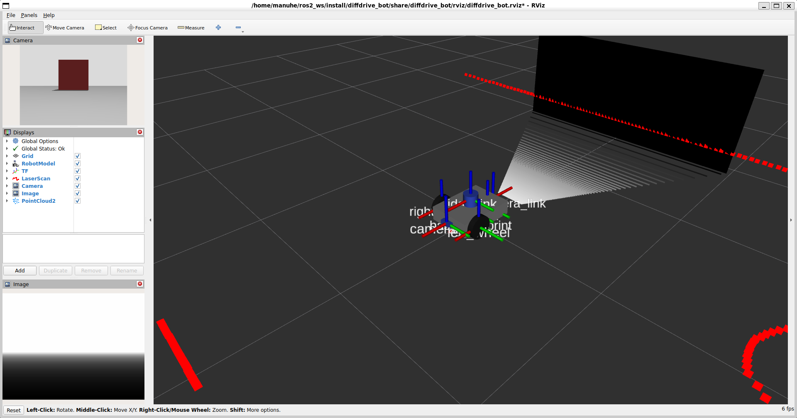
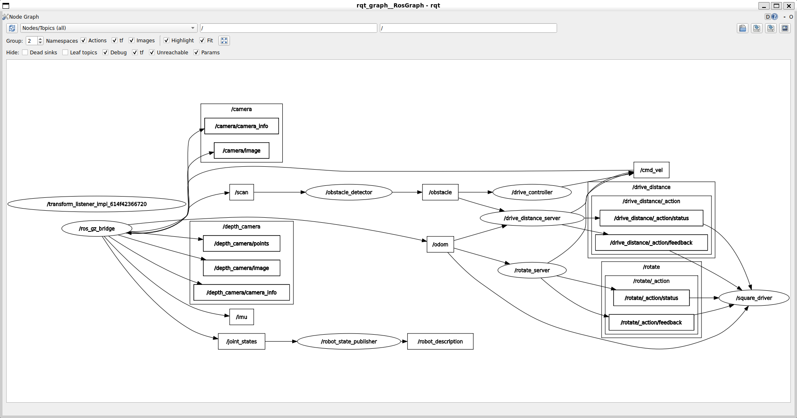

# Lab 1 Exercise: Programming diffdrive_bot

**Course:** Introduction to Robotics and Intelligent Systems, BSc in Software Engineering, 2026
**Student:** Manuhe Habtamu Mekonnen
**ID:** UGR/2808/16
**Platform:** ROS 2 Jazzy, Gazebo Harmonic, Ubuntu on WSL

In this exercise I extended the simulated differential-drive robot `diffdrive_bot` with two new sensors,
a depth camera and an IMU, and then wrote my own ROS 2 packages that drive it. Each step adds one idea
to the same node: a subscriber that reacts to obstacles, parameters, a custom message, services, an
action server, and finally an action client that drives the robot around a square.

## 1. What is in this repository

The repository holds four packages, so it builds on its own in the `src` folder of any workspace.

| Package | Build type | What it holds |
|---|---|---|
| `diffdrive_bot` | ament_cmake | The lab robot. My copy has the depth camera and IMU added in Step 1. |
| `lab_interfaces` | ament_cmake | The lab's own message, service and action types (unchanged). |
| `my_robot_interfaces` | ament_cmake | My types: the `RobotStatus` message, the `SetTurnSpeed` service and the `Rotate` action. |
| `my_robot_nodes` | ament_python | My nodes `turn_away`, `rotate_server` and `square_driver`, and the launch file `square.launch.py`. |

The interface types live in a CMake package because only CMake packages can generate message code.
The nodes live in a Python package because they are written in Python.

## 2. How to build

Clone or copy this folder into the `src` folder of a workspace, then build from the workspace root.

```bash
cd ~/ros2_ws
colcon build --symlink-install
source /opt/ros/jazzy/setup.bash
source install/setup.bash
```

Every new terminal needs both `source` lines before ROS 2 can find the packages. With
`--symlink-install`, edits to Python files, launch files and the URDF take effect after restarting the
launch, with no rebuild. A change to a `.msg`, `.srv` or `.action` file needs a rebuild.

The lab's README is written for ROS 2 Humble. I use Jazzy, so I installed the `ros-jazzy-*` versions of
the packages it lists (`ros-jazzy-ros-gz`, `ros-jazzy-xacro`, `ros-jazzy-joint-state-publisher-gui`,
`ros-jazzy-teleop-twist-keyboard`).

## 3. How each step was done and how to run it

Steps 2 to 6 need the simulation running in terminal 1:

```bash
ros2 launch diffdrive_bot control.launch.py
```

My nodes then run in terminal 2. They all publish on `/cmd_vel`, so only one of them runs at a time,
and I do not call `/drive_enable` or send goals to `/drive_distance` by hand while they drive.

### Step 1: Depth camera and IMU

**What I did.** A sensor needs three things: a place on the robot, a simulated sensor in Gazebo, and a
bridge so its data reaches ROS 2. I followed the pattern of the front camera.

- `diffdrive_bot/urdf/diffdrive_bot.urdf.xacro`: added `depth_camera_link` (same size as `camera_link`,
  with visual, collision and inertial) and a fixed joint to `base_link` at x = -0.215 m, turned half a
  turn about z so it looks backwards. Added `imu_link` and its fixed joint at the centre of the chassis.
  Added a `depth_camera` Gazebo sensor (320 x 240, `R_FLOAT32`, range 0.1 to 10 m, 10 Hz, topic
  `/depth_camera`, `camera_info_topic` `/depth_camera/camera_info`) and an `imu` sensor (50 Hz, topic `/imu`).
  Both use `gz_frame_id`, because Gazebo merges links joined by fixed joints and the frame would otherwise
  be lost.
- `diffdrive_bot/worlds/obstacles.sdf`: added the plugin `gz-sim-imu-system`, without which Gazebo does
  not simulate any IMU.
- `diffdrive_bot/config/bridge.yaml`: bridged `/depth_camera` to `/depth_camera/image`,
  `/depth_camera/points`, `/depth_camera/camera_info` and `/imu` from Gazebo to ROS 2.

**How to check.**

```bash
ros2 launch diffdrive_bot display.launch.py                  # depth camera and frames in RViz
ros2 run tf2_ros tf2_echo base_link depth_camera_link        # x = -0.215, yaw = 3.142
ros2 launch diffdrive_bot gazebo.launch.py                   # then add Image and PointCloud2 in RViz
ros2 topic hz /imu
ros2 topic echo /imu --once                                  # linear_acceleration.z about 9.8
```

In RViz, add an Image display for `/depth_camera/image` and a PointCloud2 display for `/depth_camera/points`.

### Step 2: A node that turns away from obstacles

**What I did.** `my_robot_nodes/my_robot_nodes/turn_away.py` subscribes to `/obstacle`
(`lab_interfaces/msg/ObstacleInfo`) and publishes `geometry_msgs/Twist` on `/cmd_vel`. For every
message: if `too_close` is false the robot drives forward at 0.2 m/s. If it is true the robot stops moving
forward and turns on the spot at 0.5 rad/s, away from the obstacle. `angle` is positive when the obstacle
is on the left, so the robot then turns right (negative `angular.z`), and left otherwise.

**How to run.**

```bash
ros2 run my_robot_nodes turn_away --ros-args -p use_sim_time:=true
rqt_graph                                                     # /turn_away between /obstacle and /cmd_vel
```

### Step 3: Parameters

**What I did.** I replaced the two fixed speeds with the parameters `forward_speed` (default 0.2 m/s) and
`turn_speed` (default 0.5 rad/s). They are read inside the callback each time a message arrives, not once
at start-up, so a change takes effect at once.

**How to run.**

```bash
ros2 param list /turn_away
ros2 param set /turn_away forward_speed 0.4
```

### Step 4: A message type of my own

**What I did.** In `my_robot_interfaces` I defined `msg/RobotStatus.msg` with a `string state`
("forward", "turning" or "stopped") and a `float32 obstacle_distance`. I listed it in `CMakeLists.txt`
under `rosidl_generate_interfaces`, and `package.xml` declares `rosidl_default_generators`,
`rosidl_default_runtime` and `member_of_group rosidl_interface_packages`. `turn_away` publishes a
`RobotStatus` on `/robot_status` for every `ObstacleInfo` message.

**How to run.**

```bash
ros2 interface show my_robot_interfaces/msg/RobotStatus
ros2 topic echo /robot_status
```

### Step 5: Services

**What I did.** `turn_away` serves two services.

- `/turn_away_enable` (`std_srvs/srv/SetBool`) switches the node on and off. The node starts off. While
  it is off it publishes no velocities, apart from one zero velocity when it is switched off, and its
  state is "stopped".
- `/set_turn_speed` uses my own type `my_robot_interfaces/srv/SetTurnSpeed` (request `float32 turn_speed`,
  reply `bool success` and `string message`). It rejects a speed of zero or less, or above the
  `max_turn_speed` parameter (default 1.5 rad/s). An accepted speed is stored as the `turn_speed`
  parameter, so `ros2 param get` shows it.

**How to run.**

```bash
ros2 service call /turn_away_enable std_srvs/srv/SetBool "{data: true}"
ros2 service call /set_turn_speed my_robot_interfaces/srv/SetTurnSpeed "{turn_speed: 1.0}"
ros2 service call /set_turn_speed my_robot_interfaces/srv/SetTurnSpeed "{turn_speed: 3.0}"
ros2 service call /turn_away_enable std_srvs/srv/SetBool "{data: false}"
```

The second call is accepted, the third is rejected, and the last one stops the robot.

### Step 6: An action server

**What I did.** `my_robot_interfaces/action/Rotate.action` has the goal `angle` (rad, positive turns
left), the result `turned` and the feedback `turned`. `rotate_server.py` serves `/rotate`: it turns the
robot on the spot at the `turn_speed` parameter (default 0.5 rad/s) until it has turned through the goal
angle, sends the angle turned so far as feedback, stops, and returns the angle turned. It rejects a goal
of zero and stops the robot when the goal is canceled.

The angle comes from the yaw in `/odom`. The yaw jumps from pi to -pi when the robot turns past
backwards, so the server adds up the small change in yaw between one odometry message and the next, and
the angle turned is the running sum now minus the running sum at the start of the goal. The server uses a
`MultiThreadedExecutor` and a `ReentrantCallbackGroup`, because the execute callback loops and the
odometry callback has to keep running while it does.

**How to run.**

```bash
ros2 run my_robot_nodes rotate_server --ros-args -p use_sim_time:=true
ros2 action send_goal --feedback /rotate my_robot_interfaces/action/Rotate "{angle: 1.57}"
ros2 run tf2_ros tf2_echo odom base_link
```

### Step 7: An action client and a launch file

**What I did.** `square_driver.py` is a client of two actions: `/drive_distance` from diffdrive_bot and my
`/rotate`. Four times over it sends a `DriveDistance` goal of one side length, waits for its result, then
sends a `Rotate` goal of a quarter turn (pi / 2) to the left and waits for that result. A goal is only sent
when the one before it has finished. The side length is the parameter `side_length` (default 0.5 m). If a
goal does not succeed, the node stops and logs which side it was on. It also waits for both action servers
and the first odometry message, and retries a rejected goal a few times, because the drive server rejects
goals until it has odometry.

`my_robot_nodes/launch/square.launch.py` includes diffdrive_bot's `control.launch.py` and starts
`rotate_server` and `square_driver`, with `side_length` as a launch argument. An `ament_python` package
installs launch files only when they are listed in `data_files`, so `setup.py` lists them.

**How to run.** One command starts everything (nothing else should be running):

```bash
ros2 launch my_robot_nodes square.launch.py side_length:=0.8
```

## 4. Screenshots



*Figure 1. RViz during Step 1. The Image panel (bottom left) shows the depth image from `/depth_camera/image`,
and the 3D view shows the point cloud from `/depth_camera/points` fanning out from the back of the robot
towards the wall behind it.*



*Figure 2. `rqt_graph` while `square.launch.py` runs. `/square_driver` is connected to the `/drive_distance`
and `/rotate` actions, both servers publish to `/cmd_vel`, and the chain `/scan`, `/obstacle_detector`,
`/obstacle` feeds the drive server. The depth camera topics and `/imu` from Step 1 are bridged too.*

## 5. Results

- **Step 1.** `tf2_echo base_link depth_camera_link` gave a translation of `[-0.215, 0, 0]` and a yaw of
  3.142 rad (a half turn), as required. `/imu` showed `linear_acceleration.z` of 9.80 at rest and an
  `angular_velocity.z` of about 1.13 rad/s while the robot turned.
- **Steps 2 to 5.** The robot turns away from the red box before it reaches it. A parameter change takes
  effect at once. `/robot_status` shows "forward", "turning" and "stopped". `/set_turn_speed` accepts 1.0
  and rejects 3.0 with the message that the speed must be above 0 and at most 1.5 rad/s.
- **Step 6.** A goal of 1.57 rad finished with `SUCCEEDED` and `turned: 1.5875`. A goal of 0 was rejected.
  A negative goal turned the robot right with negative feedback. Canceling a goal stopped the robot.
- **Step 7.** With `side_length:=0.8` all four drives (0.80 to 0.81 m) and all four turns (1.57 to 1.59
  rad) succeeded, and the log ended with `Square finished`. The robot ended at x = 0.031 m, y = -0.015 m,
  about 3.4 cm from where it started, with a heading error of 3.6 degrees.

## 6. What did not work and why I think so

- **The IMU rate was too low.** `ros2 topic hz /imu` showed about 15 Hz instead of 50 Hz. I think the
  simulation runs slower than real time on my computer (Ubuntu under WSL), because Gazebo renders the
  lidar, the camera and the depth camera at the same time. The rate is counted in real seconds, so a slow
  simulation publishes fewer messages per second. For the same reason a quarter turn takes much longer in
  real time than the 3 seconds it needs in simulated time.
- **RViz printed `TF_OLD_DATA` warnings.** They appeared when an earlier simulation was still running while
  I started `square.launch.py`, so two simulation clocks overlapped. Stopping everything with
  `pkill -f "gz sim"` and starting a single launch removed them.
- **The packages did not build at first.** The build failed once because the `CMakeLists.txt` files of
  `lab_interfaces` and `my_robot_interfaces` were swapped, and once because `package.xml` lacked
  `member_of_group rosidl_interface_packages`. Checking that each file has the right `project(...)` and
  `<name>` fixed both. A terminal that was sourced before a rebuild also could not find the new interfaces
  until I sourced it again.
- **The square does not close exactly.** The robot ends 3.4 cm and 3.6 degrees away from its start. I
  think each turn overshoots a little, because the loop stops only after the turned angle has passed the
  goal (the four turns added up to 6.32 rad instead of 6.28), and the wheels slip a little on the floor.
- **ROS 2 version.** The lab instructions are for Humble, but I use Jazzy, so I installed the Jazzy
  versions of the packages. The lab's files worked unchanged.
- **Harmless Gazebo warnings.** Gazebo prints `gz_frame_id ... not defined in SDF` for every sensor. It
  copies the tag anyway, and the messages carry the right frame names.

## 7. Repository layout

```
lab1_exercise/
├── README.md
├── rviz_depth.png
├── rqt_graph_square.png
├── diffdrive_bot/          (changed: URDF, world, bridge)
├── lab_interfaces/
├── my_robot_interfaces/    (msg/RobotStatus.msg, srv/SetTurnSpeed.srv, action/Rotate.action)
└── my_robot_nodes/         (turn_away.py, rotate_server.py, square_driver.py, launch/square.launch.py)
```
